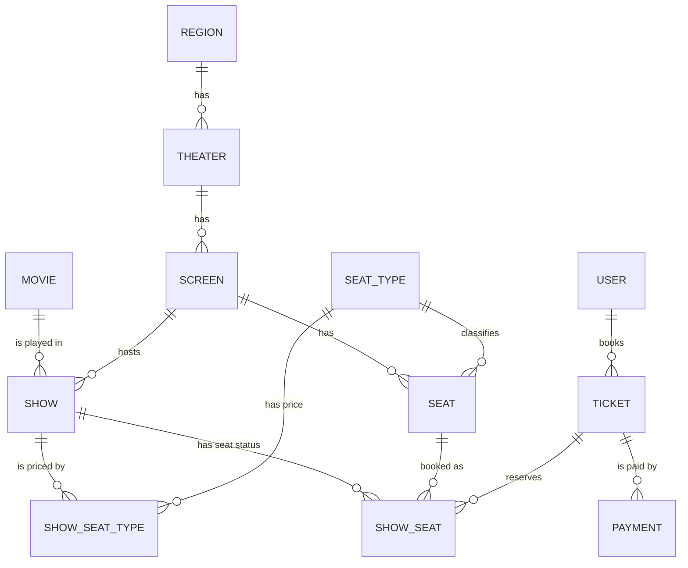

# Data Model

All entities extend `BaseModel` (`id`, `createdAt`, `updatedAt`) and live in `com.casestudy.bms.model`.

## ER diagram

## Entities

| Entity | Table | Fields | Relationships |
|---|---|---|---|
| `Region` | `region` | `name` | one-to-many `theaters` (inverse) |
| `Theater` | `theater` | `name` | many-to-one `region`; one-to-many `screens` (inverse) |
| `Screen` | `screen` | `name`, `features` | many-to-one `theater`; one-to-many `seats`, `shows` (inverse) |
| `SeatType` | `seat_type` | `seatType` (e.g. Premium, Gold) | referenced by `Seat` and `ShowSeatType` |
| `Seat` | `seat` | `number`, `row` (`bms_row`), `column` (`bms_column`) | many-to-one `screen`, many-to-one `seatType` |
| `Movie` | `movie` | `title`, `language`, `features` | one-to-many `shows` (inverse) |
| `Show` | `bms_show` | `startTime`, `endTime`, `features` | many-to-one `movie`, many-to-one `screen` |
| `ShowSeat` | `show_seat` | `seatStatus` | many-to-one `show`, `seat`, `ticket` (ticket is nullable) |
| `ShowSeatType` | `show_seat_type` | `price` | many-to-one `show`, many-to-one `seatType` |
| `User` | `bms_user` | `name`, `email`, `password` | referenced by `Ticket` |
| `Ticket` | `ticket` | `ticketNumber`, `amount`, `status` | many-to-one `user`; one-to-many `showSeat`, `payments` (inverse) |
| `Payment` | `payment` | `transactionId`, `mode`, `amount`, `status` | many-to-one `ticket` |

Table names for the unlabelled ones are Hibernate's defaults and may vary with the naming strategy. Check the generated schema if you need exact names.

## Enums

| Enum | Values | Used by |
|---|---|---|
| `Feature` | `TWO_D`, `THREE_D`, `DOLBY` | `Movie`, `Screen`, `Show` (as an element collection) |
| `SeatStatus` | `AVAILABLE`, `BOOKED`, `BLOCKED` | `ShowSeat.seatStatus` |
| `TicketStatus` | `OPEN`, `CLOSED`, `IN_PROGRESS` | `Ticket.status` |
| `PaymentMode` | `CASH`, `CARD`, `UPI` | `Payment.mode` |
| `PaymentStatus` | `PAID`, `UNPAID`, `IN_PROGRESS` | `Payment.status` |

## Owning side versus inverse side

Foreign keys live on the "many" side. The `@OneToMany(mappedBy = ...)` lists are inverse sides and are not persisted from that direction.

| Foreign key column on | Points to |
|---|---|
| `Theater` | `Region` |
| `Screen` | `Theater` |
| `Seat` | `Screen`, `SeatType` |
| `Show` | `Movie`, `Screen` |
| `ShowSeat` | `Show`, `Seat`, `Ticket` |
| `ShowSeatType` | `Show`, `SeatType` |
| `Ticket` | `User` |
| `Payment` | `Ticket` |

## Sample data

Seeded by `BookmyshowSqlApplication.run()`:

| Item | Values |
|---|---|
| Region / Theater / Screen | Mumbai / Maxus Mall / S1 (3D, Dolby) |
| Seat types | Premium, Gold |
| Seats | R1C1 (11), R1C2 (12) Premium; R2C1 (21), R2C2 (22) Gold |
| Movie | Dhrusham 3, Hindi, 3D + Dolby |
| Shows (tomorrow, IST) | Morning 06:00, Afternoon 14:00, Evening 18:00 |
| Show seats | 4 per show, all `AVAILABLE` |
| Prices | Premium 500, Gold 800 for every show |
| User | one sample user |
